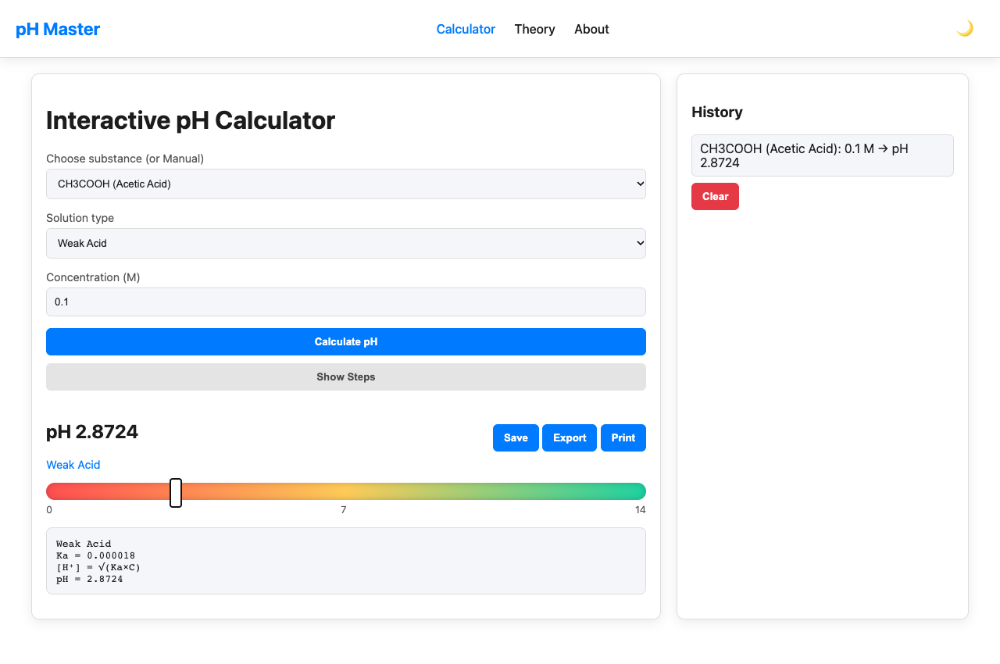

# pH Master — Interactive pH & Solution Chemistry Calculator

[](https://adorable-choux-cf076b.netlify.app/)
[](#technology-stack)
[]()

> An educational chemical computation tool that calculates pH, pOH, and hydronium/hydroxide ion concentrations for acids and bases with step-by-step mathematical derivations and real-time visual scale mapping.

[**Explore Live Calculator on Netlify**](https://adorable-choux-cf076b.netlify.app/)

---

## Application Interface



*Figure: Interactive solution configuration showing selected weak electrolyte, step-by-step mathematical equilibrium derivation, and dynamic 0–14 pH scale marker.*

---

## Overview

**pH Master** is a client-side chemistry calculator built to help students and educators explore acid-base equilibrium. It models both strong and weak electrolytes, automates multi-step logarithmic equilibrium calculations, and presents results alongside an interactive visual pH spectrum and persistent calculation logs.

---

## Calculation Workflow & Decision Engine

```mermaid
flowchart TD
    A["Select Substance & Enter Concentration (C)"] --> B{"Electrolyte Type"}
    B -->|Strong Acid| C{"Proton Stoichiometry"}
    C -->|Monoprotic: HCl, HNO3| D["[H+] = C"]
    C -->|Diprotic: H2SO4| E["[H+] = 2C"]
    B -->|Weak Acid: CH3COOH| F["[H+] = sqrt(Ka * C)"]
    B -->|Strong Base| G{"Hydroxide Stoichiometry"}
    G -->|Monoprotic: NaOH, KOH| H["[OH-] = C"]
    G -->|Diprotic: Ca(OH)2| I["[OH-] = 2C"]
    B -->|Weak Base: NH3| J["[OH-] = sqrt(Kb * C)"]
    D --> K["pH = -log10([H+])"]
    E --> K
    F --> K
    H --> L["pOH = -log10([OH-]) -> pH = 14 - pOH"]
    I --> L
    J --> L
    K --> M["Visual Spectrum Indicator + Step Derivation + Audit History"]
    L --> M
```

---

## Core Features

- **Electrolyte Classification & Presets:**
  - **Strong Acids (Monoprotic & Diprotic):** $\text{HCl}$, $\text{HNO}_3$, and $\text{H}_2\text{SO}_4$ (accounting for stoichiometric diprotic ionization: $[\text{H}^+] = 2C$).
  - **Weak Acids:** $\text{CH}_3\text{COOH}$ (Acetic Acid, $K_a = 1.8 \times 10^{-5}$), $\text{H}_2\text{CO}_3$ (Carbonic Acid, $K_a = 4.3 \times 10^{-7}$), and $\text{HCOOH}$ (Formic Acid, $K_a = 1.7 \times 10^{-4}$).
  - **Strong Bases (Monoprotic & Diprotic):** $\text{NaOH}$, $\text{KOH}$, and $\text{Ca(OH)}_2$ ($[\text{OH}^-] = 2C$).
  - **Weak Bases:** $\text{NH}_3$ (Ammonia, $K_b = 1.8 \times 10^{-5}$) and Pyridine ($K_b = 1.7 \times 10^{-9}$).
  - **Manual Mode:** Custom concentration input for arbitrary user-defined solutions.
- **Mathematical Step Breakdown:** Toggleable derivation panel displaying exact formulas, substitution of equilibrium constants ($K_a$, $K_b$), and intermediate ion concentrations before evaluating final $\text{pH}$.
- **Interactive Visual pH Spectrum:** Dynamic 0–14 color gradient scale showing solution acidity or basicity with an animated position indicator.
- **Session History:** Client-side audit log storing timestamped calculations in `localStorage` with export and clear utilities.
- **Dark & Light Mode:** Responsive UI with theme persistence stored locally.
- **Reference Pages:** Dedicated theoretical background (`theory.html`) and project information (`about.html`).

---

## Chemical Formulas & Calculations

The calculator applies standard aqueous equilibrium equations assuming $25^\circ\text{C}$ ($K_w = 1.0 \times 10^{-14}$):

1. **Strong Monoprotic Acid:**
   $$\text{pH} = -\log_{10}(C)$$

2. **Strong Diprotic Acid ($\text{H}_2\text{SO}_4$):**
   $$\text{pH} = -\log_{10}(2C)$$

3. **Weak Monoprotic Acid (Approximation where $C \gg K_a$):**
   $$[\text{H}^+] = \sqrt{K_a \cdot C} \implies \text{pH} = -\log_{10}(\sqrt{K_a \cdot C})$$

4. **Strong Monoprotic Base:**
   $$[\text{OH}^-] = C \implies \text{pH} = 14 + \log_{10}(C)$$

5. **Strong Diprotic Base ($\text{Ca(OH)}_2$):**
   $$[\text{OH}^-] = 2C \implies \text{pH} = 14 + \log_{10}(2C)$$

6. **Weak Base:**
   $$[\text{OH}^-] = \sqrt{K_b \cdot C} \implies \text{pH} = 14 + \log_{10}(\sqrt{K_b \cdot C})$$

---

## Technology Stack

- **Frontend:** Semantic HTML5, CSS3 (Custom properties, CSS Grid, Flexbox)
- **Scripting:** Vanilla JavaScript (ES6+, DOM Manipulation, `localStorage` API)
- **Zero Runtime Dependencies:** Fast load times with no external frameworks or bundle overhead
- **Deployment:** Netlify Continuous Deployment

---

## Local Development

Because pH Master is built with vanilla web technologies, no build step or package manager is required.

1. **Clone the repository:**
   ```bash
   git clone https://github.com/Kartik-idk/pH-Master-.git
   cd pH-Master-
   ```

2. **Open in browser:**
   ```bash
   open index.html # macOS
   ```
   Or serve locally using Python:
   ```bash
   python3 -m http.server 8000
   ```
   Navigate to `http://localhost:8000`.

---

## Engineering Assumptions & Limitations

- **Dilution and Activity:** Assumes ideal solution behavior (activity coefficient $\gamma = 1$). High concentrations ($> 0.1\,\text{M}$) where ionic strength substantially affects activity are not modeled with the Debye-Hückel equation.
- **Weak Acid/Base Approximations:** Uses the square-root simplification $[\text{H}^+] \approx \sqrt{K_a \cdot C}$, which is valid when ionization is under ~5%. Highly dilute weak acids approaching neutral water dissociation ($< 10^{-6}\,\text{M}$) do not solve the full cubic/quadratic autoionization equation.
- **Temperature:** Calibrated strictly for standard room temperature ($25^\circ\text{C}$, $\text{p}K_w = 14.00$).

---

## License & Permissions

Open source educational software. Feel free to use, modify, and learn from this codebase.
